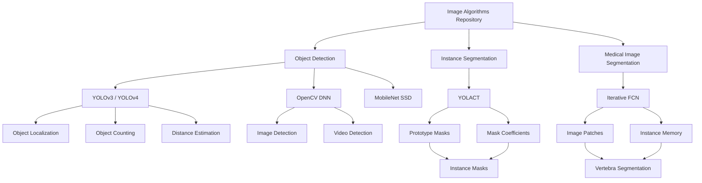

# Image Algorithms & Computer Vision

### A Collection of Image Processing, Object Detection, and Deep Learning Implementations

<p align="center">


</p>


## 1. Overview

**Image Algorithms (img-algos)** is a collection of Python-based image processing and computer vision implementations using OpenCV, PyTorch, and TensorFlow.

The repository explores classical computer vision concepts and modern deep learning architectures for visual recognition, object localization, object detection, distance estimation, and image segmentation.

It brings together several independent projects covering different aspects of computer vision, including YOLO-based object detection, real-time visual recognition, instance segmentation, and medical image analysis.

The primary objective is to provide practical implementations and experimental environments for understanding, developing, and evaluating image algorithms and deep learning-based computer vision systems.

### Main Research and Development Areas

- Image Processing and Computer Vision
- Object Detection and Localization
- Real-Time Object Detection
- Object Counting and Distance Estimation
- Convolutional Neural Networks (CNNs)
- Semantic and Instance Segmentation
- Medical Image Segmentation
- Deep Learning-Based Visual Recognition
- OpenCV and PyTorch Implementations
- TensorFlow-Based Computer Vision Models


## 2. Repository Projects

The repository currently contains four major computer vision projects.

### 2.1 Object Detection and Distance Measurement

**Directory:** `ObjDet-Distance/`

An object detection and distance estimation system based on YOLO architectures and deep learning.

The implementation uses YOLOv3 as its primary object detection model and includes a separate YOLOv4 implementation.

**Key Features**

- Real-time object detection using webcam input.
- Object localization with bounding boxes.
- Object counting.
- Approximate distance estimation using bounding-box dimensions.
- FPS monitoring.
- Multiple-camera streaming examples.
- Flask-based video streaming interface.
- YOLOv3 and YOLOv4 implementations.

**Technologies**

- Python
- PyTorch
- OpenCV
- NumPy
- Flask
- YOLOv3 / YOLOv4

**Project Structure**

```text
ObjDet-Distance/
│
├── YOLOv4/
│   ├── camera.py
│   ├── object_detection.py
│   └── ...
│
├── utils/
├── app.py
├── camera.py
├── object_detection.py
├── util.py
└── README.md
```

**Run the YOLOv3 Webcam Detection**

```bash
cd ObjDet-Distance

pip install -r requirements.txt

python object_detection.py
```

**Run the YOLOv4 Webcam Detection**

```bash
cd ObjDet-Distance/YOLOv4

python object_detection.py
```

**Important:** Download and configure the corresponding YOLO configuration files, model weights, and COCO class labels before execution.

The distance measurement is an approximate estimate derived from detected bounding-box dimensions. It should not be treated as calibrated metric depth measurement.

[Explore ObjDet-Distance](./ObjDet-Distance/)


### 2.2 YOLO Object Detection with OpenCV

**Directory:** `YOLO-OpenCV/`

A computer vision implementation demonstrating object detection using YOLOv3, OpenCV's Deep Neural Network (DNN) module, and Python.

The project uses a YOLOv3 model trained on the COCO dataset, supporting detection across 80 object categories.

**Key Features**

- Object detection in static images.
- Object detection in video files.
- Real-time webcam object detection.
- Bounding-box localization.
- Object classification with confidence scores.
- Non-Maximum Suppression (NMS).
- FPS and inference-time monitoring.

The repository also includes a separate real-time MobileNet SSD webcam detection example.

**Technologies**

- Python
- OpenCV DNN
- NumPy
- YOLOv3
- MobileNet SSD
- imutils

**Project Structure**

```text
YOLO-OpenCV/
│
├── image object dection/
│   └── yolo.py
│
├── video object dection/
│   └── yolo_video.py
│
├── real-time-object-detection/
│   └── real_time_object_detection.py
│
└── README.md
```

**Installation**

```bash
pip install numpy
pip install opencv-python
pip install imutils
```

**A. Image Object Detection**

Run from the image detection directory:

```bash
python yolo.py --image images/baggage_claim.jpg
```

**B. Video Object Detection**

Run from the video detection directory:

```bash
python yolo_video.py \
    --input videos/airport.mp4 \
    --output output/airport_output.avi \
    --yolo yolo-coco
```

**C. Real-Time Webcam Detection**

Run from the real-time detection directory:

```bash
python real_time_object_detection.py
```

**Model Requirements**

For YOLOv3, prepare:

- `yolov3.cfg`
- `yolov3.weights`
- `coco.names`

For the MobileNet SSD example, prepare:

- `MobileNetSSD_deploy.prototxt.txt`
- `MobileNetSSD_deploy.caffemodel`

**Known Limitation**

YOLOv3 may struggle with very small objects and multiple objects located close together within the same image region.

[Explore YOLO-OpenCV](./YOLO-OpenCV/)


### 2.3 YOLACT: Real-Time Instance Segmentation

**Directory:** `YOLACT-tf/`

A TensorFlow 2 implementation of YOLACT (You Only Look At CoefficienTs), a one-stage instance segmentation architecture.

Unlike conventional object detection, which primarily predicts object classes and bounding boxes, instance segmentation generates a separate pixel-level mask for each detected object.

YOLACT achieves this through two parallel components:

1. **Prototype Mask Generation:** Generates a collection of shared prototype masks.
2. **Prediction Head:** Predicts object classes, bounding boxes, and mask coefficients.

The final instance masks are assembled by combining the prototype masks with their corresponding predicted coefficients.

**Key Features**

- Real-time instance segmentation architecture.
- Prototype mask generation.
- Bounding-box prediction.
- Object classification.
- Fast Non-Maximum Suppression (Fast NMS).
- Feature Pyramid Network (FPN).
- COCO 2017 dataset support.
- Pascal SBD dataset support.
- Custom COCO-style dataset preparation.
- Configurable feature extraction backbones.

**Supported Backbones**

| Backbone | Framework |
|---|---|
| ResNet-50 | TensorFlow / Keras |
| ResNet-101 | TensorFlow / Keras |
| MobileNetV2 | TensorFlow / Keras |
| EfficientNet-B0 | TensorFlow / Keras |

**Technologies**

- Python
- TensorFlow 2
- Keras
- NumPy
- COCO Dataset
- Deep Learning

**Project Structure**

```text
YOLACT-tf/
│
├── data/
│   ├── coco_dataset.py
│   ├── coco_tfrecord_creator.py
│   └── coco_tfrecord_decoder.py
│
├── layers/
│   ├── detection.py
│   └── fpn.py
│
├── loss/
│   └── loss_yolact.py
│
├── utils/
│   ├── augmentation.py
│   ├── learning_rate_schedule.py
│   └── utils.py
│
├── config.py
├── yolact.py
├── train.py
├── eval.py
└── README.md
```

**Dataset Preparation**

The project supports COCO 2017 training and validation data.

Download:

- [COCO 2017 Training Images](http://images.cocodataset.org/zips/train2017.zip)
- [COCO 2017 Validation Images](http://images.cocodataset.org/zips/val2017.zip)
- [COCO 2017 Annotations](http://images.cocodataset.org/annotations/annotations_trainval2017.zip)

Extract the required images and annotation JSON files into the `data/` directory.

Generate TFRecord files:

```bash
python -m data.coco_tfrecord_creator \
    -train_image_dir ./data/train2017 \
    -val_image_dir ./data/val2017 \
    -train_annotations_file ./data/instances_train2017.json \
    -val_annotations_file ./data/instances_val2017.json \
    -output_dir ./data/coco
```

**Training**

Configure model parameters in `config.py`.

For COCO training:

```bash
python train.py \
    -name coco \
    -tfrecord_dir ./data \
    -weights ./weights \
    -batch_size 8 \
    -momentum 0.9 \
    -weight_decay 0.0005 \
    -print_interval 10 \
    -save_interval 5000
```

**Note:** Custom dataset configuration and several inference instructions in the existing project documentation are still incomplete.

**Original Research Paper**

Bolya et al., *YOLACT: Real-time Instance Segmentation.*

https://arxiv.org/abs/1904.02689

[Explore YOLACT-tf](./YOLACT-tf/)


### 2.4 Iterative Fully Convolutional Network (Iter-FCN)

**Directory:** `iter-FCN/`

An implementation of Iterative Fully Convolutional Networks for automatic vertebra segmentation in medical images.

The project focuses on instance-aware segmentation of individual vertebrae in three-dimensional CT and MRI image volumes.

Traditional fully convolutional networks can struggle to separate adjacent vertebrae because of anatomical similarities and complex spatial structures.

Iter-FCN addresses this challenge through an iterative segmentation strategy that uses two inputs:

1. **Image Patch:** The current three-dimensional medical image patch.
2. **Instance Memory Patch:** A memory representation of previously segmented structures.

The instance memory helps the network identify the next unsegmented vertebra and progressively segment individual structures.

**Key Features**

- Automatic vertebra segmentation.
- Three-dimensional medical image processing.
- Patch-wise segmentation.
- Instance-aware segmentation.
- Instance memory mechanism.
- Image preprocessing and resampling.
- Distance-transform-based weight calculation.
- Elastic deformation and image augmentation.
- Dice coefficient evaluation.

**Technologies**

- Python
- PyTorch
- NumPy
- SciPy
- SimpleITK
- MedPy

**Dataset**

The implementation uses the CSI2014 spine segmentation challenge dataset.

Dataset source:

[SpineWeb – Medical Image Segmentation Datasets](http://spineweb.digitalimaginggroup.ca/spineweb/index.php?n=Main.Datasets)

**Preprocessing includes**

- Resampling images and masks to isotropic 1 mm × 1 mm × 1 mm resolution.
- Calculating weight penalty coefficients using distance transforms.
- Cropping images and masks.
- Generating image patches.
- Generating instance memory patches.
- Preparing mask and weight patches.

**Project Structure**

```text
iter-FCN/
│
├── data/
│   ├── dataset.py
│   └── preprocessing.py
│
├── utils/
│   └── metrics.py
│
├── iterativeFCN.py
├── train.py
├── instance_segmentation.py
├── eval.py
└── README.md
```

**Installation**

```bash
cd iter-FCN

pip install -r requirements.txt
```

**Step 1 — Dataset Preprocessing**

```bash
python -m data.preprocessing \
    --dataset /path/to/CSI2014
```

**Step 2 — Model Training**

```bash
python train.py \
    --dataset /path/to/preprocessed_dataset
```

**Step 3 — Instance Segmentation**

```bash
python instance_segmentation.py \
    --test_dir /path/to/test/images \
    --weights /path/to/pretrained/weights
```

**Step 4 — Evaluation**

```bash
python eval.py \
    --label_dir /path/to/test/labels \
    --pred_dir /path/to/predictions
```

**Reported Segmentation Result**

The existing project documentation reports the following average Dice coefficient:

| Evaluation | Average Dice |
|---|---:|
| Repository implementation | 0.918 |
| Original paper | 0.958 |

The repository notes that additional refinement techniques for preprocessing and postprocessing were not used in its reported implementation.

These figures are reported project results, not an independently reproduced benchmark.

[Explore Iter-FCN](./iter-FCN/)


## 3. Computer Vision Concepts Covered

The repository provides practical exposure to several important computer vision concepts.

| Category | Concepts / Algorithms | Project |
|---|---|---|
| Object Detection | YOLOv3, YOLOv4 | ObjDet-Distance |
| Object Detection | YOLOv3, OpenCV DNN | YOLO-OpenCV |
| Real-Time Detection | MobileNet SSD | YOLO-OpenCV |
| Object Localization | Bounding Boxes, NMS | ObjDet-Distance, YOLO-OpenCV |
| Distance Estimation | Bounding-Box-Based Estimation | ObjDet-Distance |
| Instance Segmentation | YOLACT, Prototype Masks | YOLACT-tf |
| Feature Extraction | ResNet, MobileNetV2, EfficientNet | YOLACT-tf |
| Medical Image Segmentation | Iterative FCN, Instance Memory | iter-FCN |
| Evaluation | Dice Coefficient | iter-FCN |
| Deep Learning | CNNs, FPN, Fully Convolutional Networks | Multiple Projects |


## 4. Overall Architecture

The repository contains independent implementations that explore different computer vision tasks.




## 5. Technologies and Frameworks

The repository explores different computer vision and deep learning technologies.

### Programming Language

- Python

### Computer Vision

- OpenCV
- OpenCV DNN
- Image preprocessing
- Object localization
- Image segmentation

### Deep Learning Frameworks

- PyTorch
- TensorFlow 2
- Keras

### Deep Learning Architectures

- YOLOv3
- YOLOv4
- MobileNet SSD
- YOLACT
- ResNet
- MobileNetV2
- EfficientNet
- Fully Convolutional Networks (FCNs)

### Supporting Libraries

- NumPy
- SciPy
- Pillow
- Matplotlib
- SimpleITK
- MedPy
- imutils
- Flask


## 6. Installation and Environment Setup

Because the repository contains multiple independent implementations, each project should be configured with its own Python environment.

### Step 1 — Clone the Repository

```bash
git clone https://github.com/Miraj-Rahman-AI/img-algos.git

cd img-algos
```

### Step 2 — Create a Virtual Environment

```bash
python3 -m venv .venv
```

Activate the environment.

**macOS / Linux**

```bash
source .venv/bin/activate
```

**Windows**

```bash
.venv\Scripts\activate
```

### Step 3 — Install Project-Specific Dependencies

Navigate into the project you want to execute and install its dependencies.

For example:

```bash
cd iter-FCN

pip install -r requirements.txt
```

For other projects, follow the installation instructions in their respective README files.

### Important Compatibility Notes

- PyTorch and TensorFlow should be installed in compatible environments rather than assuming that one environment supports every project.
- The original ObjDet-Distance documentation references legacy PyTorch 1.2.0 and torchvision 0.4.0 versions. Modern Python and CUDA installations may require dependency updates.
- ObjDet-Distance imports `win32com.client` for Windows text-to-speech functionality. Running the current scripts on macOS or Linux requires modifying or replacing that Windows-specific dependency.
- The Iter-FCN inference implementation explicitly uses CUDA. CPU execution requires code modifications.
- YOLACT requires TensorFlow 2, as checked by its model implementation.


## 7. Datasets and Model Weights

Different projects require different datasets and pretrained model weights.

| Project | Dataset / Model Resources |
|---|---|
| ObjDet-Distance | YOLOv3 / YOLOv4 weights and COCO labels |
| YOLO-OpenCV | COCO pretrained YOLOv3 weights and MobileNet SSD model files |
| YOLACT-tf | COCO 2017 and Pascal SBD |
| iter-FCN | CSI2014 Spine Segmentation Dataset |

Some datasets and model weights must be downloaded separately and placed in the directories expected by the corresponding scripts.

Before running experiments, verify the configuration paths, pretrained checkpoints, dataset structure, and annotation formats.


## 8. Current Limitations

The repository contains research implementations and experimental code. Some components may require additional configuration before they can be used in a new environment.

Known considerations include:

1. **Separate Dependencies:** The projects use different deep learning frameworks and dependency versions.
2. **Hardware Compatibility:** Some implementations rely on CUDA-specific operations.
3. **Legacy Implementations:** Older model implementations may require updates to work with current Python and deep learning framework versions.
4. **Model Weights:** Certain pretrained weights and configuration files need to be obtained separately.
5. **Dataset Preparation:** Medical imaging and instance segmentation experiments require specific preprocessing pipelines.
6. **Distance Estimation:** The bounding-box-based distance estimate requires camera-specific calibration and validation for reliable real-world measurements.
7. **YOLO Limitations:** YOLOv3 may have difficulty detecting small or closely grouped objects.
8. **Incomplete Documentation:** Some YOLACT custom dataset and inference instructions remain unfinished.

The repository is intended primarily for educational, experimental, and research purposes. Experimental results should be independently validated before being used in production systems.


## 9. Future Development

Potential future improvements include:

- Implementing additional classical image processing algorithms.
- Adding more object detection architectures, including YOLOv5, YOLOv8, and newer models.
- Expanding semantic and instance segmentation implementations.
- Adding Vision Transformer (ViT)-based computer vision models.
- Improving distance estimation through camera calibration and depth estimation.
- Supporting modern PyTorch and TensorFlow versions.
- Adding reproducible evaluation scripts and standardized benchmarks.
- Improving documentation and installation procedures.
- Developing more efficient real-time computer vision applications.


## 10. References and Resources

### Object Detection

- [YOLOv3: An Incremental Improvement](https://arxiv.org/abs/1804.02767)
- [OpenCV Documentation](https://docs.opencv.org/)
- [PyTorch Documentation](https://pytorch.org/docs/stable/index.html)

### Instance Segmentation

- [YOLACT: Real-time Instance Segmentation](https://arxiv.org/abs/1904.02689)
- [COCO Dataset](https://cocodataset.org/)

### Medical Image Segmentation

- [SpineWeb Dataset Repository](http://spineweb.digitalimaginggroup.ca/spineweb/index.php?n=Main.Datasets)
- [SimpleITK Documentation](https://simpleitk.org/)

### Deep Learning Frameworks

- [TensorFlow](https://www.tensorflow.org/)
- [PyTorch](https://pytorch.org/)
- [OpenCV](https://opencv.org/)


## 12. Acknowledgments

This repository brings together different computer vision implementations and research-oriented projects, including work based on existing open-source architectures and research contributions.

Acknowledgment is given to the original researchers, authors, and developers whose models, algorithms, datasets, and open-source implementations support these projects.

Please refer to the individual project documentation for specific implementation references and attribution.

---

<p align="center">
  <strong>Image Algorithms | img-algos</strong><br>
  Computer Vision · Image Processing · Deep Learning<br>
  <em>Exploring Visual Intelligence Through Algorithms and Implementation</em>
</p>
